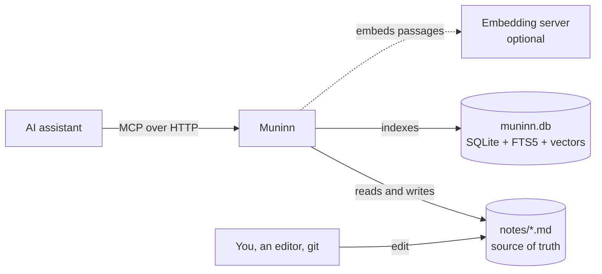

<div align="center">


# Muninn

**Long-term memory for AI assistants, kept as plain Markdown files.**

An [MCP](https://modelcontextprotocol.io) server in one static Rust binary: hybrid search, a knowledge graph and safe writes over a folder of notes you can open in any editor.

[](https://github.com/vitoramaral10/muninn-mcp/actions/workflows/ci.yml) [](LICENSE)   

[Quick start](#quick-start) · [How it works](#how-it-works) · [Tools](#tools) · [Docs](#documentation)

</div>

---

*In Norse myth, Odin sends two ravens out over the world each day: Huginn, thought, and Muninn, memory. Odin feared more for Muninn.*

Your assistant forgets everything when the conversation ends. Muninn gives it somewhere to write things down and a way to find them again: decisions, preferences, how a system was set up, why a bug happened. Everything lands in a folder of Markdown files that **you** own, read and version.

```text
you   ▸ How strong should the coffee be?
model ▸ mem_search { "query": "how strong should the coffee be?" }
        → food/coffee-brewing.md  §Method
          - [ratio] 1:16 coffee to water, by weight (adjust for the roast)
model ▸ Your note says 1:16 by weight, adjusted for the roast.
```

The note never says "strong". Hybrid search matches it by meaning.

## Highlights

<table>
<tr>
<td width="50%" valign="top">

**📝 Your notes stay yours**<br>
Each note is a Markdown file with YAML frontmatter, readable in any editor and versionable with git. The index next to them is derived: delete it and it is rebuilt.

</td>
<td width="50%" valign="top">

**🔎 Search that understands the question**<br>
Full-text BM25 (accent-insensitive) fused with embeddings from any OpenAI-compatible server by reciprocal rank. Exact names and vague questions both land.

</td>
</tr>
<tr>
<td valign="top">

**🕸️ A knowledge graph from plain lists**<br>
`- [decision] Use Postgres #db` is an observation; `- depends_on [[Auth service]]` is a relation. `mem_context` walks the graph in both directions.

</td>
<td valign="top">

**🪶 Small and quick**<br>
A 7 MB image on `scratch` that runs in about 50 MiB. On a 170-note base, hybrid search answers in 0.6 s.

</td>
</tr>
<tr>
<td valign="top">

**🔄 Edits from anywhere**<br>
A scan every 15 seconds picks up changes from an editor, `git pull` or a sync tool. Only what changed is re-embedded.

</td>
<td valign="top">

**🛡️ Safe by default**<br>
Atomic writes guarded by checksums, paths locked to the notes folder, a read-only mode that removes the write tools, and a warning when a write repeats a fact already saved.

</td>
</tr>
</table>

## Quick start

```sh
git clone https://github.com/vitoramaral10/muninn-mcp && cd muninn-mcp
docker build -t muninn-mcp .
mkdir -p notes
docker run -d --name muninn -p 127.0.0.1:8000:8000 \
  -v "$PWD/notes:/notes" -v muninn-data:/data muninn-mcp
```

Muninn now serves text search over `./notes` at `http://127.0.0.1:8000/mcp` (streamable HTTP). Connect a client:

```sh
claude mcp add --transport http muninn http://127.0.0.1:8000/mcp
```

<details>
<summary>Other MCP clients</summary>

Any client that speaks streamable HTTP works. In a JSON config such as `.mcp.json`:

```json
{
  "mcpServers": {
    "muninn": { "type": "http", "url": "http://127.0.0.1:8000/mcp" }
  }
}
```

</details>

<details>
<summary>Search by meaning (embeddings)</summary>

Point `EMBED_URL` at any OpenAI-compatible `/v1/embeddings` server. [`docker-compose.example.yml`](docker-compose.example.yml) runs Muninn next to llama.cpp serving `bge-m3`:

```sh
cp docker-compose.example.yml docker-compose.yml
# put bge-m3-Q6_K.gguf in ./models, then:
docker compose up -d
```

Without `EMBED_URL`, Muninn searches by text only. Details in [Running Muninn](docs/operations.md#the-embedding-server).

</details>

Then read [Using Muninn](docs/usage.md) for how to write notes that search well.

## How it works



The notes are the source of truth. Muninn keeps an SQLite index beside them: full-text over notes, observations and passages, and vectors cached by passage text so a rename re-embeds nothing. A search runs both sides and fuses the rankings. More in [Architecture](docs/architecture.md).

### A note

```markdown
---
title: Coffee brewing
tags: [coffee]
---

# Coffee brewing

## Method
- [method] Pour-over gives a cleaner cup than the French press #brewing
- [ratio] 1:16 coffee to water, by weight (adjust for the roast)

## Related
- relates_to [[Coffee beans]]
```

Headings split the note into passages that are searched on their own. Each `- [category]` line is an observation you can filter by category across every note. Each `- relation [[Note]]` line is an edge in the graph, and a link to a note that does not exist yet resolves once it is written.

## Tools

| Tool | Does |
|---|---|
| `mem_search` | Ranked search: hybrid, text, semantic, title or permalink. Frontmatter filters, `since`, observations and relations, grep-style `lines`. |
| `mem_read` | A note or file, whole or by section, line range or token budget. |
| `mem_write` | Create or replace a note, optionally only if unchanged since read. |
| `mem_edit` | Append, prepend, find and replace, replace or insert around a section, set frontmatter. |
| `mem_move`, `mem_delete` | A note or a whole folder. |
| `mem_list`, `mem_find` | One folder, or a recursive search by file name or frontmatter. |
| `mem_context` | A note with its observations and the notes its relations reach. |
| `mem_project` | The project, and what changed recently. |
| `mem_schema` | Validate, infer and diff frontmatter schemas (Picoschema). |
| `mem_man` | The manual, built from the tool descriptions. |

Every parameter is in the **[tool reference](docs/tools.md)**.

## Configuration

| Variable | Default | |
|---|---|---|
| `MUNINN_NOTES_DIR` | `/notes` | The notes folder. |
| `MUNINN_DATA_DIR` | `/data` | Where the index `muninn.db` lives. |
| `MUNINN_PROJECT` | `main` | The project's name in tool calls and permalinks. |
| `MUNINN_READ_ONLY` | | `1` hides the four write tools. |
| `EMBED_URL` | | OpenAI-compatible `/v1/embeddings` server. Unset: text search only. |
| `EMBED_MODEL` | `bge-m3` | Model name sent to that server. |

Every variable is in [Running Muninn](docs/operations.md#configuration).

## Documentation

| | |
|---|---|
| **[Using Muninn](docs/usage.md)** | Writing notes that search well; finding, reading and changing them; instructions for your assistant. |
| **[Running Muninn](docs/operations.md)** | Deployment, configuration, the embedding server, backups, upgrades, troubleshooting. |
| **[Architecture](docs/architecture.md)** | The note format, the index, how search ranks, writes and safety. |
| **[Tool reference](docs/tools.md)** | Every tool and parameter. |
| **[Contributing](CONTRIBUTING.md)** · **[Security](SECURITY.md)** · **[Changelog](CHANGELOG.md)** | |

## Security

> [!WARNING]
> The MCP endpoint has no authentication. Bind it to localhost, or put it behind a gateway that authenticates clients.

Paths from clients cannot leave the notes folder through `..`, hidden segments or symlinks. See [SECURITY.md](SECURITY.md).

## License

[MIT](LICENSE) © Vitor Amaral
